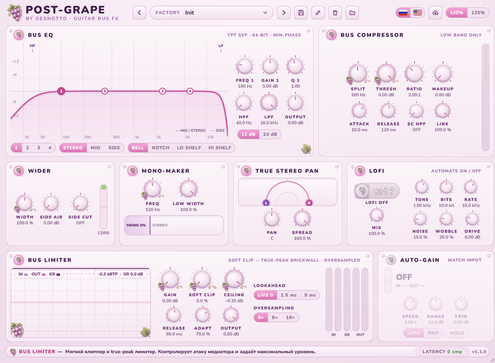

# Post-Grape

Guitar bus post-effect plugin (VST3 for Windows x64; VST3 and AU for macOS, Apple Silicon and Intel). Author: **desNotto**.

Плагин пост-обработки гитарной шины (VST3 для Windows x64; VST3 и AU для macOS, Apple Silicon и Intel). Автор: **desNotto**.



**Language / Язык:** [English](#english) · [Русский](#русский)

Text style: ASD-STE100 (Simplified Technical English). The Russian text uses the same rules: short sentences, one instruction in one sentence, the same term for the same thing.

---

# English

## 1. Purpose

Put Post-Grape at the end of a stereo bus that has an amp simulator.
The bus contains two guitars. One guitar is 100% left. One guitar is 100% right.
The plugin is for extremely low tunings and high-gain guitars.

**Main rule: zero latency.** In the default mode, the plugin reports 0 samples of latency to the DAW.

## 2. Signal chain

```
IN → Bus EQ → Bus Compressor → Wider → Mono-Maker → True Stereo Pan → Lofi → Bus Limiter → Auto-Gain → OUT
```

## 3. Controls for all modules

| Control | Function |
|---------|----------|
| Power button (grape button, at the left of the module title) | Turns the module on or off. When the module is off, the signal goes through the module without change. The change is a 10 ms crossfade, thus there are no clicks. The DAW can automate this button. |
| Knob: drag up or down | Changes the value. |
| Knob: hold Shift, click and drag | Changes the value 5 times slower (fine adjustment). |
| Knob: double-click | Sets the default value. |
| Hint bar (bottom of the window) | Move the mouse over a module: the bar shows what the module does. Move the mouse over a knob, a switch or a button: the bar shows what this control does. |

The DAW can automate all knobs and all switches.

## 4. Modules

### 4.1 Bus EQ

**Function.** The Bus EQ removes low-frequency rumble, high-frequency fizz and resonances.
It has a high-pass filter, a low-pass filter and four parametric bands.
Each band operates on the full stereo signal, on the Mid signal or on the Side signal.
All filters are minimum-phase TPT SVF filters with 64-bit processing. Thus there is no latency and no noise at low frequencies.

| Control | Range | Function |
|---------|-------|----------|
| Graph | — | Shows the frequency response. Solid line: Stereo and Mid bands. Dashed line: Side bands. Drag a node to change the frequency and the gain of the band. Turn the mouse wheel on a node to change Q. Double-click a node to set the gain to 0 dB. |
| 1 2 3 4 | — | Selects the band for the FREQ, GAIN, Q, target and type controls. |
| STEREO / MID / SIDE | — | Selects the signal for the selected band. STEREO: the left and right channels. MID: the center (both guitars together). SIDE: the difference between left and right (the stereo width). |
| BELL / NOTCH / LO SHELF / HI SHELF | — | Selects the filter type for the selected band. BELL: boost or cut near the frequency. NOTCH: full cut at the frequency (GAIN has no effect). LO SHELF: boost or cut below the frequency. HI SHELF: boost or cut above the frequency. |
| FREQ | 20 Hz – 20 kHz | Center frequency of the selected band. |
| GAIN | −18 … +18 dB | Boost or cut of the selected band. |
| Q | 0.1 – 20 | Width of the selected band. High Q = narrow band. Use Q 10–20 with a cut to remove a resonance. For shelves, Q is limited to 0.3 – 2. |
| HPF | 40 – 150 Hz | High-pass filter frequency. Removes the frequencies below this value. |
| 12 dB / 24 dB | — | Slope of the high-pass filter (dB per octave). |
| LPF | 6 – 16 kHz | Low-pass filter frequency. Removes the frequencies above this value (12 dB per octave). |
| OUTPUT | −12 … +12 dB | Output level of the EQ. |

### 4.2 Bus Compressor

**Function.** The Bus Compressor controls the low end of the palm-muted riffs.
It splits the signal into two bands at the SPLIT frequency (Linkwitz-Riley crossover, 24 dB per octave).
It compresses the low band only. The high band goes through without change.
Thus the low end stays tight and the attack of the pick stays open.

| Control | Range | Function |
|---------|-------|----------|
| SPLIT | 80 – 350 Hz | Crossover frequency. The compressor operates on the frequencies below this value. |
| THRESH | −48 … 0 dB | Threshold. The compressor starts to operate when the low band is louder than this level. 0 dB = almost no compression. |
| RATIO | 1:1 – 20:1 | Amount of compression above the threshold. 1:1 = no compression. The knee is soft (6 dB). |
| MAKEUP | 0 … +12 dB | Adds gain to the low band after the compression. |
| ATTACK | 0.1 – 100 ms | Time for the compressor to start the gain reduction. A short time catches the pick attack of the low band. |
| RELEASE | 10 – 1000 ms | Time for the compressor to stop the gain reduction. |
| SC HPF | OFF, 20 – 300 Hz | High-pass filter in the detector (sidechain). The detector ignores the frequencies below this value. Use it when the lowest notes cause too much compression. |
| LINK | 0 – 100 % | Stereo link. 100 %: the same gain reduction on the left and right channels (the stereo image stays stable). 0 %: each channel has its own gain reduction. |
| GR meter | 0 – 12 dB | Shows the gain reduction of the low band. |

### 4.3 Wider

**Function.** The Wider makes the stereo double-track wider or narrower.
It changes the level of the Side signal. It does not use a Haas delay. Thus the mono compatibility stays good.

| Control | Range | Function |
|---------|-------|----------|
| WIDTH | 0 – 200 % | Stereo width. 0 % = mono. 100 % = no change. 200 % = maximum width. |
| SIDE AIR | 0 … +9 dB | High-shelf boost of the Side signal above approx. 4.5 kHz. Adds width to the high frequencies only. |
| SIDE CUT | OFF, 20 – 400 Hz | High-pass filter on the Side signal. Removes the stereo content below this frequency. |
| CORR meter | −1 … +1 | Stereo correlation of the output. +1 (top) = mono. 0 (center line) = very wide. Below 0 = phase problems: the guitars can become quiet in mono. Keep the indicator above the center line. |

### 4.4 Mono-Maker

**Function.** The Mono-Maker makes the low frequencies mono.
Two guitars on the left and right have different low notes. This makes the low end unstable.
The Mono-Maker removes the Side signal below the crossover frequency.
The Mid signal gets the same phase shift as the Side signal, thus there is no phase cancellation.

| Control | Range | Function |
|---------|-------|----------|
| FREQ | 60 – 250 Hz | Crossover frequency. The frequencies below this value become mono. |
| LOW WIDTH | 0 – 100 % | Stereo width below FREQ. 0 % = full mono. 100 % = no change. |
| Display | — | The colored area is the mono area. The text shows the mono amount. |

### 4.5 True Stereo Pan

**Function.** The True Stereo Pan moves the stereo pair to the left or to the right.
A balance control makes one guitar quiet. The True Stereo Pan does not do this.
Each guitar has its own position. Both positions move together (as the "Stereo Pan" mode in Logic Pro).
Example: PAN = R100. The left guitar moves to the right side. It does not become silent.

| Control | Range | Function |
|---------|-------|----------|
| PAN | L100 … C … R100 | Moves both guitars to the left or to the right. C = center (no change). |
| SPREAD | 0 – 100 % | Distance between the two guitars. 100 % = left guitar at the left edge, right guitar at the right edge. 0 % = both guitars at the PAN position (mono). |
| Display | — | Shows the positions of the left guitar (L) and the right guitar (R). |

Note: with PAN = C and SPREAD = 100 %, the signal does not change.

### 4.6 Lofi

**Function.** The Lofi makes a lo-fi guitar sound: a narrow band, digital artifacts, noise and pitch wobble.
Use the LOFI switch to turn the effect on and off in a song (with automation).

| Control | Range | Function |
|---------|-------|----------|
| LOFI switch | OFF / ON | Turns the lo-fi sound on or off with a 25 ms crossfade. Automate this switch for intros and breaks. |
| MIX | 0 – 100 % | Mix of the lo-fi signal and the original signal. 100 % = lo-fi signal only. |
| TONE | 300 Hz – 6 kHz | Center of the band-pass filter. Low value = dark, "telephone" sound. High value = brighter sound. |
| BITS | 4 – 16 bit | Bit depth. Fewer bits = more digital noise and distortion. |
| RATE | 2 – 48 kHz | Sample rate of the sample-and-hold. Low value = more aliasing (metallic sound). |
| NOISE | 0 – 100 % | Level of the hiss and vinyl crackle. |
| WOBBLE | 0 – 100 % | Slow pitch drift (tape wow and flutter). Uses a delay of 0 to 4 ms. At 0 %, there is no delay. |
| DRIVE | 0 … +24 dB | Soft saturation before the filter. The level is compensated. |

### 4.7 Bus Limiter

**Function.** The Bus Limiter controls the pick transients and sets the maximum output level.
It has two stages: a soft clip and a true-peak brickwall limiter.
Both stages operate at a higher sample rate (oversampling). Thus the limiter sees the peaks between the samples (true peak).
The release is program dependent. Thus there is no distortion of the low frequencies.

| Control | Range | Function |
|---------|-------|----------|
| GAIN | 0 … +18 dB | Input gain. More gain = louder sound and more limiting. |
| SOFT CLIP | 0 – 100 % | Amount of soft clipping before the limiter. The clip makes the peaks round. Then the limiter has less work. 0 % = no clipping. |
| CEILING | −12 … 0 dBTP | Maximum output level (true peak). The default is −0.3 dBTP. |
| RELEASE | 5 – 500 ms | Base release time of the limiter. |
| ADAPT | 0 – 100 % | Program-dependent release. When the gain reduction is long, the release becomes slower (up to 5.5 times). This prevents low-frequency distortion and pumping. |
| OUTPUT | −12 … 0 dB | Output level after the limiter. |
| LOOKAHEAD | LIVE 0 / 1.5 ms / 5 ms | LIVE 0: no latency (for live play). The sample peak never goes above the ceiling. On very sharp transients, the true peak can be a little higher. 1.5 ms and 5 ms: exact true-peak limiting with latency. The plugin reports the latency to the DAW. Use these modes for mixing and export. |
| OVERSAMPLING | 4× / 8× / 16× | Oversampling factor. A higher factor gives more accurate peaks and less aliasing. It also uses more CPU. |
| Display | — | Gray area: input signal. Pink area: output signal. Dark line: gain reduction (top = 0 dB). Dashed lines: ceiling. |
| IN / GR / OUT meters | — | Input level (left, right), gain reduction, output level (left, right). |

### 4.8 Auto-Gain

**Function.** The Auto-Gain is the last module. It measures the loudness at the plugin input (before all modules) and at the plugin output.
It sets the output loudness equal to the input loudness.
Use it for a fair A/B comparison: when you turn modules on and off, the loudness stays the same. Thus you hear the change of the tone, not the change of the level.
The module has zero latency. The default is off.

| Control | Range | Function |
|---------|-------|----------|
| SPEED | 0.3 – 10 s | Time to follow a loudness change. Long time = smooth gain, no "breathing". Short time = fast follow, but the gain can follow the dynamics of the riff. |
| RANGE | 0 – 24 dB | Maximum gain correction (up and down). 0 dB = no correction. |
| TRIM | −12 … +12 dB | Offset after the matching. 0 dB = equal loudness. +2 dB = the output is 2 dB louder than the input. |
| LUFS / RMS | — | Loudness measurement. LUFS: K-weighting, as the ear hears (recommended). RMS: plain signal energy, the low end has more weight. |
| HOLD | OFF / ON | Freezes the current gain. Play the riff, wait until the gain is stable, then push HOLD. Then you hear the real level change of the knobs. |
| Gain meter | — | Gain that the module applies now. Up = boost, down = cut. Under the value: input and output loudness. |

Notes:
- In silence (input below −60 dB), the gain does not change.
- A boost never pushes the peaks above the limiter ceiling (or above 0 dBFS when the limiter is off).
- With Auto-Gain on, the limiter GAIN knob does not change the loudness. This is correct: you hear only the change of the density.

## 5. Header

| Control | Function |
|---------|----------|
| ◀ ▶ | Loads the previous or the next preset. |
| Preset name | Click to open the preset list. FACTORY = factory preset. USER = user preset. An asterisk (*) shows that the settings changed after you loaded the preset. |
| Save button | Saves the settings as a user preset. Type a name. If a different user preset has this name, the plugin asks before it replaces that preset. |
| Rename button | Gives a new name to the user preset. You cannot rename a factory preset. |
| Delete button | Deletes the user preset after a confirmation. The file goes to the Recycle Bin. You cannot delete a factory preset. |
| Folder button | Opens the user preset folder: `Documents\desNotto\Post-Grape\Presets`. |
| Flags (Russia / USA) | Language of the hints in the hint bar. Russian is the default. The labels of the controls stay in English. The choice applies to all plugin instances. |
| Cloud button | Checks for a new version on GitHub. A pink dot on the button = a new version is available. Click the button to see the version and download the zip file. |
| 100% / 125% | Scale of the plugin window. |
| Bottom-right corner | Drag to change the window size. Width and height are independent. The layout adapts. |

Factory presets: Init, Drop A Wall, Djent Tight, Doom Fog, Wide Rhythm, Left Lean, Lofi Intro, Radio Break, Master Safe.

**Bottom bar:** hint text (left), LATENCY (the latency that the plugin reports to the DAW, in samples; green 0 = no latency), plugin version (right).

### Updates

- The plugin checks GitHub for a new version one time each day when you open the plugin window. You can turn this off in the update window.
- The plugin sends only one request to `api.github.com`. It does not send any user data.
- **Download** saves the zip file to the Downloads folder and opens the folder.
- The DAW locks the plugin file while the DAW is open. Thus: close the DAW, then install the new files (see section 6) and replace the old files.
- Each system downloads its own zip: Windows takes `…-win64.zip`, macOS takes `…-macOS.zip`.

## 6. Install

### Windows

1. Download `Post-Grape-vX.Y.Z-win64.zip` from [Releases](https://github.com/desNotto/Post-Grape/releases).
2. Extract the folder `Post-Grape` to `C:\Program Files\Common Files\VST3\`. The folder contains one file: `Post-Grape.vst3` (single-file VST3).
3. Scan the plugins in the DAW.

Versions 1.0.0 – 1.1.0 installed a folder with the name `Post-Grape.vst3`. Delete this old folder before you install a new version. If you do not delete it, the DAW can show the plugin two times.

### macOS (10.13 or later, Apple Silicon and Intel)

1. Download `Post-Grape-vX.Y.Z-macOS.zip` from [Releases](https://github.com/desNotto/Post-Grape/releases) and open it. The folder `Post-Grape` contains two plugins.
2. Copy `Post-Grape.vst3` to `~/Library/Audio/Plug-Ins/VST3/` (for Ableton Live, Reaper, Cubase, Studio One, Bitwig).
3. Copy `Post-Grape.component` to `~/Library/Audio/Plug-Ins/Components/` (Audio Unit: for Logic Pro, GarageBand).
4. Scan the plugins in the DAW.

The plugin does not have an Apple notarization. If macOS blocks the plugin ("cannot be opened" or "damaged"), open Terminal and type:

```
xattr -dr com.apple.quarantine ~/Library/Audio/Plug-Ins/VST3/Post-Grape.vst3 ~/Library/Audio/Plug-Ins/Components/Post-Grape.component
```

Then restart the DAW.

## 7. Build

Requirements: Windows 10/11, Visual Studio 2022 (Build Tools are sufficient, C++ workload), CMake 3.22+, Ninja, Git.

```
git clone https://github.com/desNotto/Post-Grape.git
cd Post-Grape
git clone --depth 1 --branch 8.0.17-security https://github.com/juce-framework/JUCE.git external/JUCE
build.bat
```

If `external/JUCE` is not present, CMake downloads JUCE automatically.
The build copies the plugin (one file) to `bin\Post-Grape\Post-Grape.vst3` and runs the DSP tests (`build\PostGrapeTests.exe`).
To make the release zip, run `powershell -ExecutionPolicy Bypass -File tools\package.ps1`.

**macOS:** Xcode command line tools, CMake 3.22+, Git. Run `./build.sh`. The result is `bin/Post-Grape/Post-Grape.vst3` and `bin/Post-Grape/Post-Grape.component` (universal binary).
GitHub Actions (`.github/workflows/macos.yml`) builds and tests the macOS version for each push. When you publish a release, it attaches `Post-Grape-vX.Y.Z-macOS.zip` to the release automatically.

---

# Русский

## 1. Назначение

Ставьте Post-Grape в конец стерео-шины с амп-симом.
В шине две гитары. Одна гитара панорамирована 100% влево. Другая гитара панорамирована 100% вправо.
Плагин сделан для экстремально низких строев и high-gain гитар.

**Главное правило: нулевая задержка.** В режиме по умолчанию плагин сообщает DAW задержку 0 сэмплов.

## 2. Цепочка сигнала

```
IN → Bus EQ → Bus Compressor → Wider → Mono-Maker → True Stereo Pan → Lofi → Bus Limiter → Auto-Gain → OUT
```

## 3. Общие элементы управления

| Элемент | Функция |
|---------|---------|
| Кнопка питания (кнопка с виноградом слева от названия модуля) | Включает или выключает модуль. Выключенный модуль пропускает сигнал без изменений. Переключение идёт с кроссфейдом 10 мс, поэтому щелчков нет. DAW может автоматизировать эту кнопку. |
| Ручка: тянуть вверх или вниз | Изменяет значение. |
| Ручка: зажать Shift, кликнуть и тянуть | Изменяет значение в 5 раз медленнее (точная настройка). |
| Ручка: двойной клик | Устанавливает значение по умолчанию. |
| Строка подсказок (внизу окна) | Наведите курсор на модуль: строка показывает, что делает модуль. Наведите курсор на ручку, переключатель или кнопку: строка показывает, что делает этот элемент. |

DAW может автоматизировать все ручки и все переключатели.

## 4. Модули

### 4.1 Bus EQ

**Функция.** Bus EQ убирает низкочастотный гул, высокочастотный «песок» и резонансы.
В модуле есть фильтр высоких частот, фильтр низких частот и четыре параметрические полосы.
Каждая полоса работает на всём стерео-сигнале, на сигнале Mid или на сигнале Side.
Все фильтры — минимально-фазовые фильтры TPT SVF с 64-битной обработкой. Поэтому нет задержки и нет шума на низких частотах.

| Элемент | Диапазон | Функция |
|---------|----------|---------|
| График | — | Показывает частотную характеристику. Сплошная линия: полосы Stereo и Mid. Пунктирная линия: полосы Side. Тяните точку, чтобы изменить частоту и усиление полосы. Крутите колесо мыши на точке, чтобы изменить Q. Двойной клик по точке устанавливает усиление 0 дБ. |
| 1 2 3 4 | — | Выбирает полосу для ручек FREQ, GAIN, Q и переключателей цели и типа. |
| STEREO / MID / SIDE | — | Выбирает сигнал для выбранной полосы. STEREO: левый и правый каналы. MID: центр (обе гитары вместе). SIDE: разница между левым и правым каналом (стерео-ширина). |
| BELL / NOTCH / LO SHELF / HI SHELF | — | Выбирает тип фильтра для выбранной полосы. BELL: подъём или срез около частоты. NOTCH: полный срез на частоте (GAIN не работает). LO SHELF: подъём или срез ниже частоты. HI SHELF: подъём или срез выше частоты. |
| FREQ | 20 Гц – 20 кГц | Центральная частота выбранной полосы. |
| GAIN | −18 … +18 дБ | Подъём или срез выбранной полосы. |
| Q | 0.1 – 20 | Ширина выбранной полосы. Большой Q = узкая полоса. Для удаления резонанса используйте Q 10–20 и срез. Для полок Q ограничен диапазоном 0.3 – 2. |
| HPF | 40 – 150 Гц | Частота фильтра высоких частот. Убирает частоты ниже этого значения. |
| 12 dB / 24 dB | — | Крутизна фильтра высоких частот (дБ на октаву). |
| LPF | 6 – 16 кГц | Частота фильтра низких частот. Убирает частоты выше этого значения (12 дБ на октаву). |
| OUTPUT | −12 … +12 дБ | Выходной уровень эквалайзера. |

### 4.2 Bus Compressor

**Функция.** Bus Compressor контролирует низ риффов с глушением (palm mute).
Модуль делит сигнал на две полосы на частоте SPLIT (кроссовер Линквица-Райли, 24 дБ на октаву).
Модуль сжимает только низкую полосу. Высокая полоса проходит без изменений.
Поэтому низ остаётся плотным, а атака медиатора остаётся открытой.

| Элемент | Диапазон | Функция |
|---------|----------|---------|
| SPLIT | 80 – 350 Гц | Частота кроссовера. Компрессор работает на частотах ниже этого значения. |
| THRESH | −48 … 0 дБ | Порог. Компрессор начинает работать, когда низкая полоса громче этого уровня. 0 дБ = компрессии почти нет. |
| RATIO | 1:1 – 20:1 | Степень сжатия выше порога. 1:1 = компрессии нет. Колено мягкое (6 дБ). |
| MAKEUP | 0 … +12 дБ | Добавляет усиление низкой полосе после компрессии. |
| ATTACK | 0.1 – 100 мс | Время, за которое компрессор начинает снижать усиление. Короткое время ловит атаку медиатора в низкой полосе. |
| RELEASE | 10 – 1000 мс | Время, за которое компрессор прекращает снижать усиление. |
| SC HPF | OFF, 20 – 300 Гц | Фильтр высоких частот в детекторе (сайдчейн). Детектор не реагирует на частоты ниже этого значения. Используйте его, когда самые низкие ноты дают слишком сильную компрессию. |
| LINK | 0 – 100 % | Стерео-связь. 100 %: одинаковое снижение усиления в левом и правом каналах (стерео-картина стабильна). 0 %: у каждого канала своё снижение усиления. |
| Индикатор GR | 0 – 12 дБ | Показывает снижение усиления низкой полосы. |

### 4.3 Wider

**Функция.** Wider делает стерео-даблтрек шире или уже.
Модуль изменяет уровень сигнала Side. Модуль не использует задержку Хааса. Поэтому совместимость с моно остаётся хорошей.

| Элемент | Диапазон | Функция |
|---------|----------|---------|
| WIDTH | 0 – 200 % | Стерео-ширина. 0 % = моно. 100 % = без изменений. 200 % = максимальная ширина. |
| SIDE AIR | 0 … +9 дБ | Подъём высоких частот сигнала Side полкой выше примерно 4.5 кГц. Добавляет ширину только на высоких частотах. |
| SIDE CUT | OFF, 20 – 400 Гц | Фильтр высоких частот на сигнале Side. Убирает стерео-информацию ниже этой частоты. |
| Индикатор CORR | −1 … +1 | Стерео-корреляция выхода. +1 (вверху) = моно. 0 (центральная линия) = очень широко. Ниже 0 = проблемы с фазой: в моно гитары могут стать тише. Держите индикатор выше центральной линии. |

### 4.4 Mono-Maker

**Функция.** Mono-Maker делает низкие частоты моно.
У двух гитар слева и справа разные низкие ноты. Из-за этого низ становится нестабильным.
Mono-Maker убирает сигнал Side ниже частоты кроссовера.
Сигнал Mid получает такой же фазовый сдвиг, как сигнал Side. Поэтому нет фазового подавления.

| Элемент | Диапазон | Функция |
|---------|----------|---------|
| FREQ | 60 – 250 Гц | Частота кроссовера. Частоты ниже этого значения становятся моно. |
| LOW WIDTH | 0 – 100 % | Стерео-ширина ниже FREQ. 0 % = полное моно. 100 % = без изменений. |
| Дисплей | — | Цветная область — это моно-область. Текст показывает степень моно. |

### 4.5 True Stereo Pan

**Функция.** True Stereo Pan сдвигает стерео-пару влево или вправо.
Обычный баланс делает одну гитару тише. True Stereo Pan так не делает.
У каждой гитары своя позиция. Обе позиции сдвигаются вместе (как режим «Stereo Pan» в Logic Pro).
Пример: PAN = R100. Левая гитара сдвигается вправо. Она не становится тихой.

| Элемент | Диапазон | Функция |
|---------|----------|---------|
| PAN | L100 … C … R100 | Сдвигает обе гитары влево или вправо. C = центр (без изменений). |
| SPREAD | 0 – 100 % | Расстояние между двумя гитарами. 100 % = левая гитара у левого края, правая гитара у правого края. 0 % = обе гитары в позиции PAN (моно). |
| Дисплей | — | Показывает позиции левой гитары (L) и правой гитары (R). |

Примечание: при PAN = C и SPREAD = 100 % сигнал не изменяется.

### 4.6 Lofi

**Функция.** Lofi делает лоу-фай звук гитары: узкая полоса, цифровые артефакты, шум и «плавание» высоты тона.
Используйте переключатель LOFI, чтобы включать и выключать эффект в песне (через автоматизацию).

| Элемент | Диапазон | Функция |
|---------|----------|---------|
| Переключатель LOFI | OFF / ON | Включает или выключает лоу-фай звук с кроссфейдом 25 мс. Автоматизируйте этот переключатель для интро и брейков. |
| MIX | 0 – 100 % | Смесь лоу-фай сигнала и исходного сигнала. 100 % = только лоу-фай сигнал. |
| TONE | 300 Гц – 6 кГц | Центр полосового фильтра. Малое значение = тёмный «телефонный» звук. Большое значение = более яркий звук. |
| BITS | 4 – 16 бит | Разрядность. Меньше бит = больше цифрового шума и искажений. |
| RATE | 2 – 48 кГц | Частота дискретизации sample-and-hold. Малое значение = больше алиасинга (металлический звук). |
| NOISE | 0 – 100 % | Уровень шипения и треска винила. |
| WOBBLE | 0 – 100 % | Медленное «плавание» высоты тона (детонация плёнки). Использует задержку от 0 до 4 мс. При 0 % задержки нет. |
| DRIVE | 0 … +24 дБ | Мягкая сатурация перед фильтром. Уровень компенсируется. |

### 4.7 Bus Limiter

**Функция.** Bus Limiter контролирует транзиенты медиатора и устанавливает максимальный выходной уровень.
В модуле два каскада: мягкий клиппер и true-peak брикволл-лимитер.
Оба каскада работают на повышенной частоте дискретизации (оверсэмплинг). Поэтому лимитер видит пики между сэмплами (true peak).
Время восстановления зависит от материала. Поэтому нет искажений низких частот.

| Элемент | Диапазон | Функция |
|---------|----------|---------|
| GAIN | 0 … +18 дБ | Входное усиление. Больше усиления = громче звук и сильнее лимитирование. |
| SOFT CLIP | 0 – 100 % | Степень мягкого клиппинга перед лимитером. Клиппер скругляет пики. Тогда лимитеру меньше работы. 0 % = клиппинга нет. |
| CEILING | −12 … 0 dBTP | Максимальный выходной уровень (true peak). По умолчанию −0.3 dBTP. |
| RELEASE | 5 – 500 мс | Базовое время восстановления лимитера. |
| ADAPT | 0 – 100 % | Восстановление, зависящее от материала. Когда снижение усиления длится долго, восстановление становится медленнее (до 5.5 раза). Это предотвращает искажения низких частот и «качание». |
| OUTPUT | −12 … 0 дБ | Выходной уровень после лимитера. |
| LOOKAHEAD | LIVE 0 / 1.5 ms / 5 ms | LIVE 0: задержки нет (для игры вживую). Сэмпл-пик никогда не превышает потолок. На очень резких транзиентах true peak может быть немного выше. 1.5 ms и 5 ms: точное true-peak лимитирование с задержкой. Плагин сообщает задержку DAW. Используйте эти режимы для сведения и экспорта. |
| OVERSAMPLING | 4× / 8× / 16× | Коэффициент оверсэмплинга. Больший коэффициент даёт более точные пики и меньше алиасинга. Он также сильнее нагружает процессор. |
| Дисплей | — | Серая область: входной сигнал. Розовая область: выходной сигнал. Тёмная линия: снижение усиления (вверху = 0 дБ). Пунктирные линии: потолок. |
| Индикаторы IN / GR / OUT | — | Входной уровень (левый, правый), снижение усиления, выходной уровень (левый, правый). |

### 4.8 Auto-Gain

**Функция.** Auto-Gain — последний модуль. Он измеряет громкость на входе плагина (до всех модулей) и на выходе плагина.
Модуль делает громкость выхода равной громкости входа.
Используйте его для честного сравнения A/B: когда вы включаете и выключаете модули, громкость не меняется. Поэтому вы слышите изменение тембра, а не изменение уровня.
Задержки нет. По умолчанию модуль выключен.

| Элемент | Диапазон | Функция |
|---------|----------|---------|
| SPEED | 0.3 – 10 с | Время, за которое усиление догоняет изменение громкости. Долго = плавное усиление без «дыхания». Быстро = быстрая реакция, но усиление может следовать за динамикой риффа. |
| RANGE | 0 – 24 дБ | Максимальная коррекция усиления (вверх и вниз). 0 дБ = коррекции нет. |
| TRIM | −12 … +12 дБ | Сдвиг после выравнивания. 0 дБ = равная громкость. +2 дБ = выход на 2 дБ громче входа. |
| LUFS / RMS | — | Способ измерения громкости. LUFS: K-взвешивание, как слышит ухо (рекомендуется). RMS: чистая энергия сигнала, низ весит больше. |
| HOLD | OFF / ON | Замораживает текущее усиление. Сыграйте рифф, подождите, пока усиление успокоится, и нажмите HOLD. Тогда слышно настоящее изменение уровня от ручек. |
| Индикатор усиления | — | Усиление, которое модуль применяет сейчас. Вверх = подъём, вниз = срез. Под значением: громкость входа и выхода. |

Примечания:
- В тишине (вход ниже −60 дБ) усиление не меняется.
- Подъём никогда не выводит пики выше потолка лимитера (или выше 0 dBFS, если лимитер выключен).
- При включённом Auto-Gain ручка GAIN лимитера не меняет громкость. Это правильно: вы слышите только изменение плотности.

## 5. Верхняя панель

| Элемент | Функция |
|---------|---------|
| ◀ ▶ | Загружает предыдущий или следующий пресет. |
| Имя пресета | Клик открывает список пресетов. FACTORY = заводской пресет. USER = пользовательский пресет. Звёздочка (*) показывает, что настройки изменились после загрузки пресета. |
| Кнопка сохранения | Сохраняет настройки как пользовательский пресет. Введите имя. Если это имя уже есть у другого пользовательского пресета, плагин спрашивает, заменить ли его. |
| Кнопка переименования | Даёт пользовательскому пресету новое имя. Заводской пресет переименовать нельзя. |
| Кнопка удаления | Удаляет пользовательский пресет после подтверждения. Файл попадает в Корзину. Заводской пресет удалить нельзя. |
| Кнопка папки | Открывает папку пользовательских пресетов: `Documents\desNotto\Post-Grape\Presets`. |
| Флаги (Россия / США) | Язык подсказок в строке подсказок. По умолчанию русский. Надписи на элементах остаются на английском. Выбор действует для всех экземпляров плагина. |
| Кнопка-облако | Проверяет новую версию на GitHub. Розовая точка на кнопке = есть новая версия. Нажмите кнопку, чтобы увидеть версию и скачать zip-файл. |
| 100% / 125% | Масштаб окна плагина. |
| Правый нижний угол | Тяните, чтобы изменить размер окна. Ширина и высота меняются независимо. Раскладка подстраивается. |

Заводские пресеты: Init, Drop A Wall, Djent Tight, Doom Fog, Wide Rhythm, Left Lean, Lofi Intro, Radio Break, Master Safe.

**Нижняя строка:** текст подсказки (слева), LATENCY (задержка, которую плагин сообщает DAW, в сэмплах; зелёный 0 = задержки нет), версия плагина (справа).

### Обновления

- Плагин проверяет новую версию на GitHub один раз в день, когда вы открываете окно плагина. Это можно выключить в окне обновления.
- Плагин отправляет только один запрос на `api.github.com`. Он не отправляет никаких данных о пользователе.
- **Download** сохраняет zip-файл в папку «Загрузки» и открывает эту папку.
- Пока DAW открыта, она блокирует файл плагина. Поэтому: закройте DAW, установите новые файлы (см. раздел 6) и замените старые.
- Каждая система скачивает свой zip: Windows берёт `…-win64.zip`, macOS берёт `…-macOS.zip`.

## 6. Установка

### Windows

1. Скачайте `Post-Grape-vX.Y.Z-win64.zip` со страницы [Releases](https://github.com/desNotto/Post-Grape/releases).
2. Распакуйте папку `Post-Grape` в `C:\Program Files\Common Files\VST3\`. В папке один файл: `Post-Grape.vst3` (VST3 одним файлом).
3. Пересканируйте плагины в DAW.

Версии 1.0.0 – 1.1.0 устанавливали папку с именем `Post-Grape.vst3`. Удалите эту старую папку перед установкой новой версии. Если её не удалить, DAW может показать плагин два раза.

### macOS (10.13 и новее, Apple Silicon и Intel)

1. Скачайте `Post-Grape-vX.Y.Z-macOS.zip` со страницы [Releases](https://github.com/desNotto/Post-Grape/releases) и откройте его. В папке `Post-Grape` два плагина.
2. Скопируйте `Post-Grape.vst3` в `~/Library/Audio/Plug-Ins/VST3/` (для Ableton Live, Reaper, Cubase, Studio One, Bitwig).
3. Скопируйте `Post-Grape.component` в `~/Library/Audio/Plug-Ins/Components/` (Audio Unit: для Logic Pro, GarageBand).
4. Пересканируйте плагины в DAW.

У плагина нет нотаризации Apple. Если macOS блокирует плагин («не удаётся открыть» или «повреждён»), откройте Терминал и введите:

```
xattr -dr com.apple.quarantine ~/Library/Audio/Plug-Ins/VST3/Post-Grape.vst3 ~/Library/Audio/Plug-Ins/Components/Post-Grape.component
```

Затем перезапустите DAW.

## 7. Сборка

Требования: Windows 10/11, Visual Studio 2022 (достаточно Build Tools с рабочей нагрузкой C++), CMake 3.22+, Ninja, Git.

```
git clone https://github.com/desNotto/Post-Grape.git
cd Post-Grape
git clone --depth 1 --branch 8.0.17-security https://github.com/juce-framework/JUCE.git external/JUCE
build.bat
```

Если папки `external/JUCE` нет, CMake скачивает JUCE автоматически.
Сборка копирует плагин (один файл) в `bin\Post-Grape\Post-Grape.vst3` и запускает DSP-тесты (`build\PostGrapeTests.exe`).
Чтобы сделать zip для релиза, запустите `powershell -ExecutionPolicy Bypass -File tools\package.ps1`.

**macOS:** Xcode command line tools, CMake 3.22+, Git. Запустите `./build.sh`. Результат: `bin/Post-Grape/Post-Grape.vst3` и `bin/Post-Grape/Post-Grape.component` (универсальный бинарник).
GitHub Actions (`.github/workflows/macos.yml`) собирает и тестирует macOS-версию при каждом push. Когда вы публикуете релиз, он автоматически прикрепляет к релизу `Post-Grape-vX.Y.Z-macOS.zip`.

---

## Source layout / Структура исходников

| Path | Contents / Содержимое |
|------|-----------------------|
| `src/dsp/` | DSP code (C++20, 64-bit, no JUCE) / DSP-код (C++20, 64 бит, без JUCE) |
| `src/gui/` | Look-and-feel, knobs, switches, meters, displays, panels / Внешний вид, ручки, переключатели, индикаторы, дисплеи, панели |
| `src/Params.*` | Parameter IDs and ranges / ID и диапазоны параметров |
| `src/PresetManager.*` | Factory and user presets / Заводские и пользовательские пресеты |
| `tests/dsp_tests.cpp` | DSP tests / DSP-тесты |
| `design/` | UI mockup, architecture notes / Макет интерфейса, описание архитектуры |
| `ui-list.png` | UI sheet (visual style source) / UI-лист (источник визуального стиля) |

## License / Лицензия

Post-Grape: GNU Affero General Public License v3.0 (`LICENSE`).
JUCE 8 is used under the AGPLv3. The Nunito font is used under the SIL Open Font License 1.1 (`assets/fonts/OFL.txt`).

JUCE 8 используется по лицензии AGPLv3. Шрифт Nunito используется по лицензии SIL Open Font License 1.1 (`assets/fonts/OFL.txt`).
